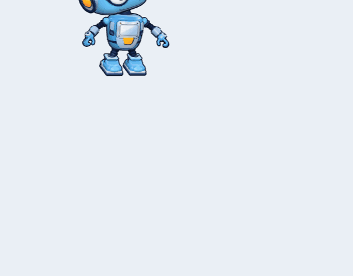
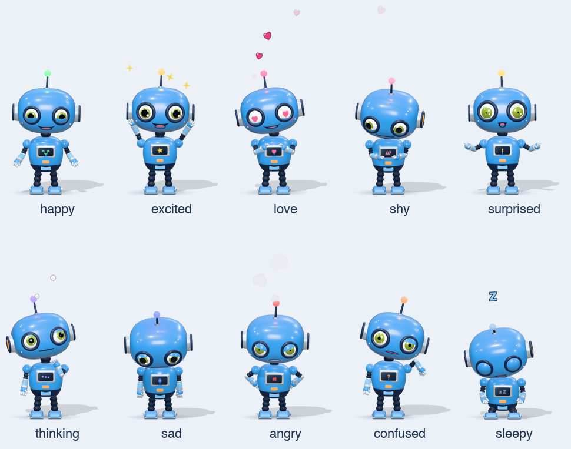

<h1 align="center">Blu 🤖</h1>

<p align="center">
  หุ่นยนต์ 3D ตัวจิ๋วที่เดินเล่นอยู่บนจอ Mac คุยได้ทั้งพิมพ์และพูด (ภาษาไทย) และแสดงอารมณ์ผ่านหน้าตาและท่าทาง<br>
  A tiny 3D robot that lives on your Mac's screen, chats by text or voice (in Thai) and shows how it feels.
</p>

<p align="center"></p>

<p align="center"><b>ภาษาไทย</b> · <a href="#english">English</a></p>

---

## ภาษาไทย

Blu เป็นหุ่นยนต์ 3D (Three.js) ที่อยู่ขอบล่างของจอ ใช้ [Ollama](https://ollama.com) เป็นสมองตอบคำถาม
และใช้โมเดลภาษาไทยที่รันในเครื่องสำหรับพูด ([Wayu-Paxa-TTS-Edge](https://huggingface.co/wayu-ai/wayu-paxa-tts-edge))
และฟัง ([Typhoon ASR Realtime](https://huggingface.co/typhoon-ai/typhoon-asr-realtime))

### ทำอะไรได้บ้าง

- **มีชีวิต** เดินไปมา มองตามเมาส์ กะพริบตา เอียงหัว นั่ง ยืดเส้น เต้น และหลับเมื่อไม่มีใครเล่นด้วย
  ทุกการเคลื่อนไหวขับด้วย spring จึงลื่นและเด้งดึ๋ง (เสาอากาศ หัว และตัวสั่นเหมือนเยลลี่)
- **คุย** คลิกที่ตัวหุ่นแล้วพิมพ์ คำตอบขึ้นในบับเบิลพร้อมขยับปากตาม
- **พูดและฟัง** กด Ctrl ซ้าย 2 ครั้งแล้วพูดได้เลย หุ่นพูดตอบด้วยเสียงจริงและขยับปากตามความดังของเสียง
- **มีอารมณ์** โมเดลใส่แท็กอารมณ์ไว้ในคำตอบ หุ่นจะเปลี่ยนสีหน้า ท่าทาง สีไฟเสาอากาศ จอที่หน้าอก
  และเอฟเฟกต์ (หัวใจ น้ำตา ไอโกรธ Zzz) ตามไปด้วย และเปลี่ยนอารมณ์กลางประโยคได้
- **เล่นด้วยได้** ลากหุ่นแล้วโยน (โยนแรงๆ จะมึน) เอาเมาส์ลูบไปมาให้ดีใจ จิ้มรัวๆ จะโกรธ

<p align="center"></p>
<p align="center"><sub>ดีใจ · ตื่นเต้น · รัก · เขิน · ตกใจ · คิด · เศร้า · โกรธ · งง · ง่วง/หลับ</sub></p>

### สิ่งที่ต้องมี

- Mac ชิป Apple silicon (ทดสอบบน macOS 26, M4)
- [Node.js](https://nodejs.org) 20 ขึ้นไป
- [Ollama](https://ollama.com) จะรันในเครื่องนี้หรือเครื่องอื่นในบ้านก็ได้ พร้อมโมเดลแชทสักตัว
- [uv](https://docs.astral.sh/uv/) สำหรับระบบเสียง (`brew install uv`)
- Xcode Command Line Tools สำหรับปุ่ม Ctrl 2 ครั้ง (`xcode-select --install`)
- พื้นที่ว่างประมาณ 3 GB (package ของ Python 1.6 GB + โมเดลเสียง 0.75 GB + Electron)

### ติดตั้ง

```bash
git clone https://github.com/mockupcode/ai-companion.git
```

```bash
cd ai-companion
```

```bash
npm run setup
```

ตัวติดตั้งจะถามแค่ **ที่อยู่ของ Ollama** (เช่น `http://localhost:11434` หรือ `http://192.168.1.20:11434`)
และ **โมเดลที่จะใช้** (ดึงรายชื่อจาก Ollama มาให้เลือก) แล้วจะติดตั้ง package ทั้งหมด
โหลดโมเดลเสียงจาก Hugging Face ทดสอบพูด-ฟังให้ และ build ทุกอย่างเอง ไม่ต้องตั้งค่าอื่น

```bash
npm start
```

หุ่นจะตกลงมาจากขอบบนจอแล้วทักทาย ตัวแอปไม่มีไอคอนใน Dock ให้ใช้ 🤖 ที่ menu bar หรือคลิกขวาที่ตัวหุ่น

> ถ้าไม่ต้องการเสียง (ประหยัดพื้นที่ 2.3 GB) ใช้ `npm run setup -- --no-speech` หุ่นจะพูดด้วยเสียงในตัวของ macOS แทน
> และปิดการสั่งด้วยเสียง

### วิธีเล่น

| ทำอะไร | ผลลัพธ์ |
| --- | --- |
| คลิกที่หุ่น | เปิดช่องพิมพ์คุย (Enter ส่ง, Esc ปิด) |
| กด **Ctrl ซ้าย 2 ครั้ง** หรือปุ่ม 🎤 | พูดกับหุ่น พูดจบแล้วเงียบประมาณ 1 วินาที มันจะหยุดฟังเอง |
| `Cmd+Shift+Space` / `Cmd+Shift+M` | เปิดช่องคุย / พูด จากที่ไหนก็ได้ |
| ลากแล้วปล่อย | หุ่นห้อยตามเมาส์ ปล่อยแรงๆ คือโยน |
| เอาเมาส์ลูบไปมาบนหุ่น | ดีใจจนตาเป็นรูปหัวใจ |
| คลิกขวา | เมนู: คุย พูด เต้น นอน/ตื่น ความดังเสียง ล้างความจำ ออก |

### ตั้งค่า (`config.json`)

ปกติต้องแก้แค่สองค่านี้ ซึ่ง `npm run setup` ถามให้แล้ว:

```json
{
  "ollamaHost": "http://localhost:11434",
  "model": "deepseek-v4.1-flash:cloud"
}
```

<details>
<summary>ค่าอื่นที่ปรับได้ (ใส่เพิ่มใน config.json)</summary>

| key | ค่าเริ่มต้น | ความหมาย |
| --- | --- | --- |
| `name` | `Blu` | ชื่อหุ่น (ใส่ใน prompt ด้วย) |
| `scale` | `0.9` | ขนาดหุ่นบนจอ |
| `temperature` | `0.8` | ความสร้างสรรค์ของคำตอบ |
| `historyLimit` | `24` | จำบทสนทนาย้อนหลังกี่ข้อความ |
| `shortcut` / `talkShortcut` | `Cmd+Shift+Space` / `Cmd+Shift+M` | คีย์ลัดเปิดช่องคุย / พูด |
| `doubleCtrl` | `true` | กด Ctrl ซ้าย 2 ครั้งเพื่อพูด |
| `asr` | `true` | เปิดระบบฟังเสียง |
| `ttsEngine` | `wayu` | `say` = ใช้เสียงในตัว macOS |
| `ttsVoice` | `f_teen_bright` | เสียงอื่นของ Wayu เช่น `f_young_bright`, `f_young_clear`, `m_teen_bright`, `m_young_clear` |
| `ttsSpeed` | `1.0` | ความเร็วพูด |
| `speechIdleMinutes` | `10` | ปิดโมเดลเสียงเพื่อคืน RAM เมื่อไม่ได้ใช้นานเท่านี้ (0 = ไม่ปิด) |
| `voiceTh` / `voiceEn` / `speechRate` | `Kanya` / `Samantha` / `185` | เสียงสำรองของ macOS |

</details>

### สิทธิ์ที่ macOS จะขอ

- **ไมโครโฟน**: ตอนพูดกับหุ่นครั้งแรก
- **Input Monitoring** สำหรับ `keytap` (ตัวจับการกด Ctrl 2 ครั้ง): อนุญาตใน System Settings → Privacy & Security → Input Monitoring
- **Local Network**: ถ้า Ollama อยู่อีกเครื่อง ถ้ายังไม่ได้อนุญาต แอปจะส่งคำขอผ่าน `curl` ของระบบแทนเอง

### แก้ปัญหา

- **"ต่อ Ollama ที่ … ไม่ได้"** เช็กที่อยู่ใน `config.json` และว่า Ollama รันอยู่
  ถ้า Ollama อยู่อีกเครื่อง ให้เครื่องนั้นเปิดรับจากเครือข่ายด้วย `OLLAMA_HOST=0.0.0.0 ollama serve`
  ส่วนโมเดลที่ลงท้ายด้วย `:cloud` ต้อง `ollama signin` บนเครื่องที่รัน Ollama ก่อน
- **ตอบครั้งแรกช้า และขึ้น "กำลังตื่น…"** เป็นเรื่องปกติ ระบบเสียงกำลังโหลดโมเดล (ประมาณ 15 วินาที)
- **กด Ctrl 2 ครั้งแล้วไม่มีอะไรเกิดขึ้น** ดูว่าเปิดสิทธิ์ Input Monitoring ให้ `keytap` แล้ว
  ถ้าไม่มีในลิสต์ กด + แล้วเลือก `build/keytap` ในโฟลเดอร์โปรเจกต์
- **เสียงแข็งๆ เหมือนเสียงระบบ** ระบบเสียงยังไม่ได้ติดตั้งหรือโหลดไม่ขึ้น ลองรัน
  `.venv/bin/python speech/server.py --selftest`
- **ใช้ RAM เยอะ** โมเดลเสียงใช้ประมาณ 1.5–2 GB ขณะโหลดอยู่ และจะคืนเองเมื่อไม่ได้ใช้ (`speechIdleMinutes`)
  หรือตั้ง `"asr": false` / `"ttsEngine": "say"`

### โมเดลและไลเซนส์

โค้ดของโปรเจกต์นี้ใช้ไลเซนส์ [Apache-2.0](LICENSE) ส่วนโมเดลที่ตัวติดตั้งโหลดมาใช้มีไลเซนส์ของตัวเอง:

| ส่วน | ไลเซนส์ |
| --- | --- |
| [Wayu-Paxa-TTS-Edge](https://huggingface.co/wayu-ai/wayu-paxa-tts-edge) (เสียงพูด) | CC-BY-NC-4.0: **ห้ามใช้เชิงพาณิชย์** และอยู่ภายใต้ [Acceptable Use ของ Wayu Research](https://www.wayuresearch.org/terms#acceptable-use) |
| [Typhoon ASR Realtime](https://huggingface.co/typhoon-ai/typhoon-asr-realtime) (การฟัง) | CC-BY-4.0 และ [เงื่อนไขของ OpenTyphoon](https://opentyphoon.ai/tac) |
| Three.js, Electron | MIT |

โมเดลไม่ได้อยู่ใน repo นี้ ตัวติดตั้งจะโหลดจาก Hugging Face ให้ และเสียงที่สร้างขึ้นเป็นเสียงสังเคราะห์

### โครงสร้างโปรเจกต์

```text
src/main/         Electron main process
  index.js          หน้าต่างโปร่งใสคลุมจอ, เมนู, IPC
  chat.js           คุยกับ Ollama แบบ streaming (+ system prompt ที่สั่งให้ใส่แท็กอารมณ์)
  speech.js         จัดการ speech server, เสียงสำรอง `say`, คืน RAM เมื่อว่าง
  keytap.js         รับสัญญาณ Ctrl 2 ครั้งจาก helper
  config.js         ค่าตั้งและข้อมูลผู้ใช้
src/renderer/     หน้าจอ (bundle ด้วย esbuild)
  robot3d.js        ตัวหุ่น 3D: rig, สีหน้า, ท่าทาง, spring/jelly
  app.js            ฉาก, พฤติกรรม, ฟิสิกส์ลาก/โยน, อินพุต
  chatui.js         บับเบิล, ช่องพิมพ์, จังหวะข้อความให้ตรงกับเสียง
  sound.js          เสียงเอฟเฟกต์, เล่นเสียงพูด + ปรับความดัง + lip sync
  listen.js         อัดเสียงไมค์ + ตรวจจับว่าพูดจบ
  face.js, fx.js    ปาก/จอหน้าอก (canvas texture), particle
  tags.js           แยกแท็กอารมณ์ออกจากข้อความที่ stream มา
src/native/keytap.swift   ตัวจับการกด Ctrl ซ้าย 2 ครั้ง
speech/server.py          Wayu TTS + Typhoon ASR ใน process เดียว (JSON ผ่าน stdin/stdout)
speech/requirements.lock  package ของ Python ที่ล็อกเวอร์ชันไว้
scripts/setup.mjs         ตัวติดตั้ง
```

**พัฒนาต่อ:** แก้โค้ดแล้ว `npm start` (build ให้อัตโนมัติ) หรือดูเฉพาะตัวหุ่นในเบราว์เซอร์ได้:
`npm run build:ui` แล้ว `python3 -m http.server 5199 --directory src/renderer` แล้วเปิด
`http://localhost:5199/?scale=2.5` กด `1`–`0`, `-` เพื่อสลับอารมณ์ และ `w n s d j h p t l` เพื่อเล่นท่าทาง

---

## English

Blu is a 3D (Three.js) robot that lives along the bottom of your screen. [Ollama](https://ollama.com) is its
brain; local Thai models give it a voice ([Wayu-Paxa-TTS-Edge](https://huggingface.co/wayu-ai/wayu-paxa-tts-edge))
and ears ([Typhoon ASR Realtime](https://huggingface.co/typhoon-ai/typhoon-asr-realtime)). The app's UI and voice
are Thai; the model replies in whatever language you write in.

### Features

- **Feels alive:** walks around, follows your cursor with its eyes, blinks, tilts its head, sits, stretches,
  dances, and dozes off when left alone. Everything moves on springs, so the antenna, head and body wobble like jelly.
- **Chat:** click it and type; the reply appears in a speech bubble while its mouth moves.
- **Talk and listen:** double-tap the left Control key and just speak. It answers out loud, lip-synced to the audio.
- **Emotions:** the model tags its replies with emotions and gestures; the face, pose, antenna light, chest screen
  and effects (hearts, tears, steam, Zzz) follow, even changing mid-sentence.
- **Play with it:** drag and throw it (too hard and it gets dizzy), rub it with the cursor, or poke it too often.

<p align="center"></p>

### Requirements

- A Mac with Apple silicon (tested on macOS 26, M4)
- [Node.js](https://nodejs.org) 20+
- [Ollama](https://ollama.com), on this Mac or another machine on your network, with a chat model
- [uv](https://docs.astral.sh/uv/) for the speech models (`brew install uv`)
- Xcode Command Line Tools for the double-Ctrl trigger (`xcode-select --install`)
- About 3 GB of disk (1.6 GB Python packages, 0.75 GB speech models, Electron)

### Install

```bash
git clone https://github.com/mockupcode/ai-companion.git
```

```bash
cd ai-companion
```

```bash
npm run setup
```

Setup only asks for **your Ollama address** (e.g. `http://localhost:11434` or `http://192.168.1.20:11434`) and
**which model** to use (it lists what that Ollama has). It then installs everything, downloads the speech models
from Hugging Face, tests speaking and listening, and builds the app.

```bash
npm start
```

Blu drops in from the top of the screen and says hello. There's no Dock icon: use 🤖 in the menu bar or
right-click the robot.

> Don't want voice (saves 2.3 GB)? Use `npm run setup -- --no-speech`. Blu then speaks with the built-in macOS
> voice and voice input is off.

### Controls

| Do | Result |
| --- | --- |
| Click the robot | Open the chat box (Enter sends, Esc closes) |
| **Double-tap left Ctrl**, or the 🎤 button | Talk to it; it stops listening after about a second of silence |
| `Cmd+Shift+Space` / `Cmd+Shift+M` | Open the chat box / talk, from anywhere |
| Drag and release | Carry it around; let go while moving to throw it |
| Rub the cursor over it | It gets happy, then heart-eyed |
| Right-click | Menu: chat, talk, dance, sleep/wake, voice volume, forget the conversation, quit |

### Configuration (`config.json`)

Usually only these two, which `npm run setup` asks for:

```json
{
  "ollamaHost": "http://localhost:11434",
  "model": "deepseek-v4.1-flash:cloud"
}
```

<details>
<summary>Optional settings</summary>

| key | default | meaning |
| --- | --- | --- |
| `name` | `Blu` | The robot's name (also used in the prompt) |
| `scale` | `0.9` | Size on screen |
| `temperature` | `0.8` | Reply creativity |
| `historyLimit` | `24` | Messages of conversation to remember |
| `shortcut` / `talkShortcut` | `Cmd+Shift+Space` / `Cmd+Shift+M` | Open chat / talk |
| `doubleCtrl` | `true` | Double-tap left Control to talk |
| `asr` | `true` | Speech recognition |
| `ttsEngine` | `wayu` | `say` = built-in macOS voices |
| `ttsVoice` | `f_teen_bright` | Other Wayu voices: `f_young_bright`, `f_young_clear`, `m_teen_bright`, `m_young_clear`, … |
| `ttsSpeed` | `1.0` | Speaking speed |
| `speechIdleMinutes` | `10` | Unload the speech models after this long unused (0 = never) |
| `voiceTh` / `voiceEn` / `speechRate` | `Kanya` / `Samantha` / `185` | Fallback macOS voices |

</details>

### macOS permissions

- **Microphone:** the first time you talk to it.
- **Input Monitoring** for `keytap` (the double-Ctrl helper): System Settings → Privacy & Security → Input Monitoring.
- **Local Network:** if Ollama runs on another machine. Until it's granted, Blu routes requests through the system
  `curl`, which macOS allows.

### Troubleshooting

- **"ต่อ Ollama ที่ … ไม่ได้" (can't reach Ollama):** check the address in `config.json` and that Ollama is running.
  On another machine, Ollama has to listen on the network: `OLLAMA_HOST=0.0.0.0 ollama serve`.
  Models ending in `:cloud` need `ollama signin` on the Ollama machine.
- **First reply is slow and says "กำลังตื่น…" (waking up):** the speech models are loading (about 15 s).
- **Double-Ctrl does nothing:** give `keytap` Input Monitoring permission; if it isn't listed, press + and pick
  `build/keytap` in the project folder.
- **It sounds like the stock macOS voice:** speech isn't installed or failed to load. Run
  `.venv/bin/python speech/server.py --selftest`.
- **Memory:** the speech models take about 1.5–2 GB while loaded and are released when idle (`speechIdleMinutes`),
  or turn them off with `"asr": false` / `"ttsEngine": "say"`.

### Models and licenses

The code in this repository is licensed under [Apache-2.0](LICENSE). The models setup downloads have their own licenses:

| Part | License |
| --- | --- |
| [Wayu-Paxa-TTS-Edge](https://huggingface.co/wayu-ai/wayu-paxa-tts-edge) (voice) | CC-BY-NC-4.0: **no commercial use**, plus the [Wayu Research acceptable use terms](https://www.wayuresearch.org/terms#acceptable-use) |
| [Typhoon ASR Realtime](https://huggingface.co/typhoon-ai/typhoon-asr-realtime) (listening) | CC-BY-4.0 and the [OpenTyphoon terms](https://opentyphoon.ai/tac) |
| Three.js, Electron | MIT |

The models are not part of this repository; setup downloads them from Hugging Face. The voice is synthetic.

### Project layout

```text
src/main/         Electron main process
  index.js          the transparent full-screen window, menu, IPC
  chat.js           streaming chat with Ollama (+ the system prompt asking for emotion tags)
  speech.js         speech server lifecycle, `say` fallback, idle unloading
  keytap.js         double-Ctrl events from the helper
  config.js         settings and per-user state
src/renderer/     what you see (bundled with esbuild)
  robot3d.js        the 3D robot: rig, expressions, poses, springs/jelly
  app.js            scene, behaviour, drag/throw physics, input
  chatui.js         speech bubble, input box, keeping text in step with the voice
  sound.js          sound effects, voice playback + loudness + lip sync
  listen.js         microphone recording + end-of-speech detection
  face.js, fx.js    mouth/chest screen (canvas textures), particles
  tags.js           pulls emotion tags out of the streamed reply
src/native/keytap.swift   double-tap-left-Control detector
speech/server.py          Wayu TTS + Typhoon ASR in one process (JSON over stdin/stdout)
speech/requirements.lock  pinned Python packages
scripts/setup.mjs         the installer
```

**Hacking on it:** edit and `npm start` (it rebuilds). To work on the robot alone in a browser:
`npm run build:ui`, then `python3 -m http.server 5199 --directory src/renderer` and open
`http://localhost:5199/?scale=2.5`. Keys `1`–`0` and `-` switch emotions; `w n s d j h p t l` play gestures.
